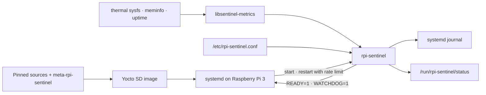

# RPi Sentinel

RPi Sentinel is a C health monitor for Raspberry Pi 3 Model B. The project
builds a minimal AArch64 Linux image with Yocto, packages the monitor in a
custom layer, and verifies service recovery on the target board.

The monitor reads CPU temperature, memory usage, and uptime from Linux.
It evaluates configurable thresholds with hysteresis, logs samples to
the systemd journal, and publishes a local JSON snapshot at
`/run/rpi-sentinel/status` using atomic file replacement.



## Build and test the application

On Ubuntu, install the host dependencies and run CMake and CTest from the
repository root.

```bash
sudo apt install build-essential cmake libsystemd-dev pkg-config python3

build_dir=$(mktemp -d)
cmake -S libsentinel-metrics -B "$build_dir/metrics" -DCMAKE_BUILD_TYPE=Release &&
cmake --build "$build_dir/metrics" --parallel &&
cmake --install "$build_dir/metrics" --prefix "$build_dir/install" &&
cmake -S app -B "$build_dir/app" -DCMAKE_BUILD_TYPE=Release -DBUILD_TESTING=ON \
  -DCMAKE_PREFIX_PATH="$build_dir/install" &&
cmake --build "$build_dir/app" --parallel &&
ctest --test-dir "$build_dir/app" --output-on-failure --no-tests=error
```

GitHub Actions runs the same application build and tests on Ubuntu 24.04.
The tests use controlled input and a local Unix socket. They run without
Raspberry Pi hardware.

## Build and deploy the Yocto image

Use the [fresh-clone build guide](docs/yocto-build.md) to build
`rpi-sentinel-image` with Yocto Project **6.0.4 Wrynose**, BitBake
**2.18.0**, `MACHINE=raspberrypi3-64`, `DISTRO=poky`, and systemd.
[sources.lock](build-config/sources.lock) pins the exact upstream Git
commits. The guide covers SHA256 verification, writing the microSD card,
and provisioning Wi-Fi and key-based SSH locally.

## What has been verified

| Check | Evidence |
| --- | --- |
| Host build and tests | 4 CTest cases passed locally and on GitHub Actions after the shared library was introduced. |
| Raspberry Pi 3 | The board booted, accepted key-based SSH, and published live temperature, RAM and uptime samples. |
| Recovery | Tested automatic service restart after `SIGKILL` and watchdog expiry, then start-rate limiting and manual recovery. |
| Experimental kernel diagnostics image | The host build passed. On the board, `/proc/config.gz` showed both expected settings and the monitor passed the live smoke test. |

Recovery covers the monitor service. A hardware watchdog and automatic
board reset are outside the implemented scope.

## Repository guide

- [Architecture](docs/architecture.md)
- [Test procedures and results](docs/testing.md) and [recovery scenarios](docs/recovery.md)
- [Troubleshooting](docs/troubleshooting.md)

The monitor and project tooling are available under the [MIT License](LICENSE).
The optional [out-of-tree module](docs/kernel-module.md) is licensed under
GPL-2.0-only. Packages included in a Yocto image carry their own licenses.
