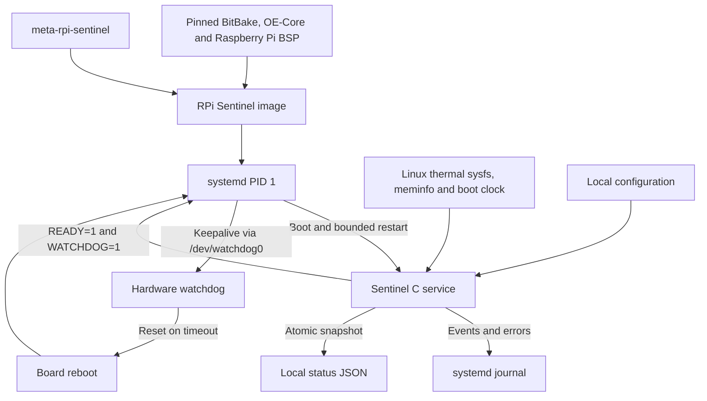

# RPi Sentinel architecture

## Platform

The baseline is Yocto Project 6.0.4 (Wrynose LTS), with the Wrynose
branch of meta-raspberrypi, `MACHINE = "raspberrypi3-64"`,
`DISTRO = "rpi-sentinel"`, and `INIT_MANAGER = "systemd"`.
The custom `rpi-sentinel-image` will build on `core-image-minimal` and
include the Sentinel package, its service unit, and the components
required for boot and local console diagnostics. Confirm the SD image
format and package manifest against the pinned BSP during integration.

As of 2026-11-24, the published release table lists Blacksail 6.1.0
(stable through April 2027), Wrynose 6.0.4 (LTS through April 2030),
and Scarthgap 5.0.21 (LTS through April 2028). The release calendar
schedules Blacksail 6.1.1 for the week of November 23. The Layer Index
lists dedicated Wrynose and Scarthgap BSP branches. It shows current
BSP development on master, and a dedicated Blacksail branch and exact
compatible revision remain unverified. Wrynose lists both Raspberry Pi 3
machine variants and provides the longest LTS horizon of these series.

- [Yocto releases](https://www.yoctoproject.org/development/releases/)
- [Release calendar](https://wiki.yoctoproject.org/wiki/Release_calendar)
- [Wrynose BSP](https://layers.openembedded.org/layerindex/branch/wrynose/layer/meta-raspberrypi/)
- [Scarthgap BSP](https://layers.openembedded.org/layerindex/branch/scarthgap/layer/meta-raspberrypi/)
- [BSP development branch](https://layers.openembedded.org/layerindex/branch/master/layer/meta-raspberrypi/)

AArch64 uses the 64-bit capabilities of the Cortex-A53 and shares an
application binary interface (ABI) with other AArch64 Linux systems.
The ABI defines how compiled programs and libraries interoperate,
including calling conventions and type layout. The 32-bit variant can
reduce memory overhead in pointer-heavy structures and accommodate
legacy ARM binaries. The Raspberry Pi 3 Model B has 1 GB of RAM.
Compare actual memory use and image size on the device if a 32-bit
profile becomes relevant.

## Components



## Application lifecycle

1. systemd starts the service as a dedicated account. The process
   validates `/etc/rpi-sentinel.conf` and publishes its first snapshot
   before sending `READY=1`. Invalid configuration prevents startup
   and produces a diagnostic. Changes take effect after a service restart.
2. The main loop samples every 5 seconds by default, with a configurable
   interval capped at 10 seconds. It reads the CPU thermal zone by type
   from `/sys/class/thermal`, calculates RAM usage as
   `(MemTotal - MemAvailable) / MemTotal` from `/proc/meminfo`, and
   reads uptime via `CLOCK_BOOTTIME`. Confirm the CPU zone type on the
   target. Missing or invalid readings mark the affected metric
   unavailable and the snapshot degraded.
3. Upper temperature and RAM alarms use configurable hysteresis. Uptime
   is informational. Log alarm activation, clearance, and measurement
   loss and recovery to journald. Publish schema version, boot-relative
   sample time, values, units, and status in
   `/run/rpi-sentinel/status.json`. Write a temporary file in the same
   directory and replace the snapshot using `rename()`. The snapshot
   and the journal are volatile in the MVP.
4. With `Type=notify`, `WatchdogSec=30s`, and `Restart=on-failure`,
   systemd recovers the service after a crash or a stalled sampling loop.
   The main loop sends `WATCHDOG=1` after processing a cycle, including
   a cycle that successfully reports missing measurements. Alarm
   transitions leave the service running. A start-rate limit leaves a
   repeatedly failing service in the failed state for operator diagnosis.
5. PID 1 owns the board watchdog via `RuntimeWatchdogSec=` and
   `/dev/watchdog0`. Confirm device availability and the effective
   timeout on hardware. If hardware keepalives stop after the watchdog
   is armed, expiry resets the board. A normal service stop handles
   `SIGTERM` and exits cleanly.

- [systemd service watchdog](https://www.freedesktop.org/software/systemd/man/258/systemd.service.html)
- [systemd hardware watchdog](https://www.freedesktop.org/software/systemd/man/258/systemd.conf.d.html)

## Repository layout

The tree describes the intended layout as implementation and test
material become available.

```text
README.md
LICENSE
.gitignore
app/
  CMakeLists.txt
  include/                 # when headers are shared
  src/
  tests/
meta-rpi-sentinel/
  conf/layer.conf
  conf/distro/rpi-sentinel.conf
  recipes-core/images/
  recipes-core/systemd/
  recipes-apps/rpi-sentinel/
build-config/sources.lock
tests/device/smoke-test.sh
docs/
  architecture.md
  requirements.md
  build-guide.md
  testing.md
  troubleshooting.md
  yocto-experiments.md
.github/workflows/
```

The application recipe owns the service unit. Image-level systemd
configuration owns the hardware watchdog policy. Keeping project
metadata in its own layer makes downstream changes reviewable and
allows upstream revisions to be updated as a tested set.

## Source pinning

Use `build-config/sources.lock` as the future source of truth for upstream
URLs, full Git commit IDs, and enabled layer paths. Yocto 6.0.4 publishes
the following revisions:

| Repository | Git revision | Enabled layer path |
| --- | --- | --- |
| [BitBake](https://git.openembedded.org/bitbake) | `51fd94a67fa17650a9ff623492005972bbc7d26f` | Build tool |
| [OpenEmbedded-Core](https://git.openembedded.org/openembedded-core) | `0f03c732a0a2d0506b41b1abe60b3f368b2300dc` | `meta` |
| [meta-raspberrypi](https://git.yoctoproject.org/meta-raspberrypi) | Select and validate a specific commit from `wrynose` during integration | Repository root |

The project commit identifies the application, image configuration, and
`meta-rpi-sentinel` together. Pin any further layer required by the
validated configuration in the same manifest. Pin recipe Git revisions
and archive checksums. Record the supported build host, the effective
configuration, and artifact checksums. Keep build outputs, downloads,
and shared-state caches outside version control on a native Linux
filesystem with sufficient space.

[Yocto 6.0.4 release source revisions](https://docs.yoctoproject.org/wrynose/migration-guides/release-notes-6.0.4.html)
