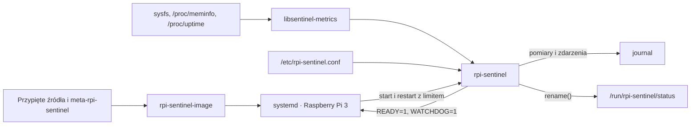

# Architektura RPi Sentinel

## Platforma

Projekt używa Yocto Project 6.0.4 Wrynose i BitBake 2.18.0.
Własna warstwa rozszerza `core-image-minimal` o pakiet monitora.
Konfiguracja to `MACHINE=raspberrypi3-64`, `DISTRO=poky` oraz
`INIT_MANAGER=systemd`. Docelowy sprzęt zweryfikowany w próbach to
Raspberry Pi 3 Model B Rev 1.2. Wariant 64-bitowy używa ABI AArch64.
Profil 32-bitowy pozostaje możliwym rozszerzeniem, z osobnymi próbami
zgodności i zużycia RAM.

[Manifest przypiętych źródeł](../build-config/sources.lock) wskazuje
rewizje BitBake, OE-Core, meta-yocto i BSP Raspberry Pi. Własna warstwa
oraz konfiguracja obrazu pochodzą z checkoutu projektu.
[Instrukcja budowania](yocto-build.md) opisuje trzy profile i artefakty.

## Komponenty

## Cykl życia

1. Systemd uruchamia monitor jako `DynamicUser` i tworzy katalog
   `/run/rpi-sentinel` przez `RuntimeDirectory`. Aplikacja wczytuje
   `/etc/rpi-sentinel.conf` przed pierwszą próbką. Zmiana konfiguracji
   obowiązuje po ponownym uruchomieniu procesu.
2. Biblioteka C czyta strefę termiczną `cpu-thermal`, `MemTotal` i
   `MemAvailable` oraz czas od rozruchu. Zwraca milistopnie Celsjusza,
   KiB, milisekundy albo kody błędów. Pętla korzysta z zegara
   monotonicznego. Domyślny interwał to 5 s, a dopuszczalny zakres to
   1–10 s.
3. Aplikacja ocenia progi temperatury i RAM z histerezą. Wzrost poziomu
   następuje przy osiągnięciu progu, a spadek po zejściu poniżej granicy
   wynikającej z histerezy. Uptime jest metryką informacyjną. Brak
   metryki powoduje stan `ERROR` z zachowaniem dostępnych odczytów.
4. Pomiary JSON i zdarzenia trafiają do journalu. Plik statusu jest
   zastępowany przez `rename()` po zapisaniu pliku tymczasowego w tym
   samym katalogu. Czytelnik dostaje kompletny plik. Stan w `/run`
   znika po restarcie urządzenia.
5. Po pierwszym zakończonym cyklu monitor wysyła `READY=1`. Watchdog
   usługi oczekuje `WATCHDOG=1` z głównej pętli. Obsłużony błąd
   metryki jest raportowany, a pętla nadal potwierdza postęp. Po
   awarii lub 30 s bez heartbeat systemd podejmuje restart po 2 s.
   Cztery starty w ciągu 120 s wyczerpują limit. Przy zwykłym
   zatrzymaniu monitor obsługuje `SIGTERM`.
6. Obraz konsolowy wystarcza do lokalnego monitorowania. Profil
   Wi-Fi i SSH używa kluczy publicznych dla konta `developer`.
   Uprawnienia do wywoływania awarii są dostępne w osobnym profilu
   testowym. Sprzętowy watchdog i automatyczny reset urządzenia
   pozostają poza zakresem wdrożenia.

## Struktura repozytorium

| Ścieżka | Rola |
| --- | --- |
| `app/` | Monitor C, konfiguracja i testy CTest. |
| `libsentinel-metrics/` | Biblioteka współdzielona z publicznym API pomiarów. |
| `common/` | Prywatne nagłówki używane przez bibliotekę i aplikację. |
| `meta-rpi-sentinel/` | Receptury aplikacji, biblioteki, obrazu i pakietu testowego. |
| `build-config/` | Przypięte rewizje oraz konfiguracja hosta i profilu Wi-Fi. |
| `scripts/` | Budowa obrazu bazowego, zapis karty, konfiguracja, diagnostyka i smoke test. |
| `.github/workflows/` | Kompilacja aplikacji i CTest na runnerze Ubuntu. |
| `docs/` | Budowanie, testy, diagnostyka, recovery i materiały publikacyjne. |

Artefakty obrazu trafiają lokalnie do `artifacts/`. Dane Wi-Fi i klucze
prywatne pozostają poza historią Git.
