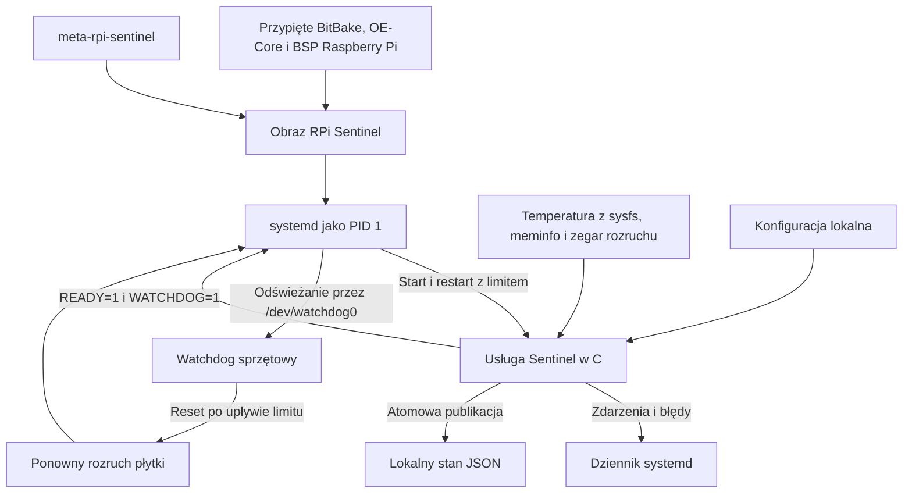

# Architektura RPi Sentinel

## Platforma

Bazą jest Yocto Project 6.0.4 (Wrynose LTS) z gałęzią `wrynose` warstwy
`meta-raspberrypi`, `MACHINE = "raspberrypi3-64"`,
`DISTRO = "rpi-sentinel"` i `INIT_MANAGER = "systemd"`. Docelowy
`rpi-sentinel-image` będzie oparty na `core-image-minimal` i zawrze pakiet
Sentinel, jednostkę usługi i komponenty potrzebne do rozruchu oraz
diagnostyki konsolowej. Format obrazu SD i manifest pakietów sprawdzimy
dla przypiętego BSP. Etap 2 używa referencyjnego `DISTRO = "poky"`.

MVP korzysta z konsoli lokalnej. Opcjonalny profil deweloperski dopuszcza
SSH z kluczem publicznym i wyłącza uwierzytelnianie hasłem. Klucze publiczne
dostarczamy osobno, a klucze prywatne przechowujemy poza repozytorium.

Według tabeli wydań z 24 listopada 2026 r. Blacksail 6.1.0 ma wsparcie
do kwietnia 2027 r., Wrynose 6.0.4 LTS do kwietnia 2030 r., a
Scarthgap 5.0.21 LTS do kwietnia 2028 r. Kalendarz przewidywał
Blacksail 6.1.1 na tydzień od 23 listopada. Indeks warstw wykazuje
gałęzie BSP dla Wrynose i Scarthgap oraz bieżący rozwój na `master`.
Osobna gałąź i zgodna rewizja dla Blacksail pozostały niepotwierdzone.
Wrynose obejmuje oba warianty Raspberry Pi 3 i ma najdłuższy okres LTS.

- [Wydania Yocto](https://www.yoctoproject.org/development/releases/)
- [Kalendarz wydań](https://wiki.yoctoproject.org/wiki/Release_calendar)
- [BSP Wrynose](https://layers.openembedded.org/layerindex/branch/wrynose/layer/meta-raspberrypi/)
- [BSP Scarthgap](https://layers.openembedded.org/layerindex/branch/scarthgap/layer/meta-raspberrypi/)
- [Gałąź rozwojowa BSP](https://layers.openembedded.org/layerindex/branch/master/layer/meta-raspberrypi/)

AArch64 wykorzystuje 64-bitowy tryb Cortex-A53 i wspólny interfejs binarny
aplikacji (ABI) dla systemów Linux AArch64. ABI określa współpracę
skompilowanych programów i bibliotek, w tym sposób wywoływania funkcji
oraz układ typów. Wariant 32-bitowy może zmniejszyć zużycie pamięci
przez struktury ze wskaźnikami i obsługiwać starsze binaria ARM.
Raspberry Pi 3 Model B ma 1 GB RAM. Jeśli powstanie profil 32-bitowy,
porównamy na płytce zużycie pamięci i rozmiar obrazu.

## Komponenty



## Cykl życia aplikacji

1. systemd uruchamia usługę na dedykowanym koncie. Aplikacja sprawdza
   `/etc/rpi-sentinel.conf` i publikuje pierwszy stan przed wysłaniem
   `READY=1`. Błędna konfiguracja przerywa start i daje komunikat
   diagnostyczny. Zmiany obowiązują po restarcie usługi.
2. Pętla wykonuje pomiar domyślnie co 5 s, a maksymalny interwał to 10 s.
   Szuka strefy CPU po typie w `/sys/class/thermal`, oblicza
   `(MemTotal - MemAvailable) / MemTotal` z `/proc/meminfo` i odczytuje
   uptime przez `CLOCK_BOOTTIME`. Typ strefy potwierdzimy na urządzeniu.
   Błędny lub niedostępny odczyt oznacza metrykę jako niedostępną i
   raportuje stan zdegradowany.
3. Górne progi temperatury i RAM mają konfigurowalną histerezę. Uptime
   jest informacyjny. Włączenie i ustąpienie alarmu oraz utratę i powrót
   pomiaru zapisujemy w journald. W `/run/rpi-sentinel/status.json`
   publikujemy wersję schematu, czas od rozruchu, pomiary, jednostki
   i status. Plik tymczasowy z tego samego katalogu zastępuje poprzedni
   przez `rename()`. Stan i dziennik są ulotne w MVP.
4. Przy `Type=notify`, `WatchdogSec=30s` i `Restart=on-failure` systemd
   odzyskuje usługę po awarii lub zawieszeniu pętli. Po obsłużeniu cyklu
   pętla wysyła `WATCHDOG=1`, również gdy poprawnie zgłosiła brak pomiaru.
   Alarm pozostawia usługę uruchomioną. Po przekroczeniu limitu restartów
   usługa pozostaje w stanie `failed` do diagnostyki.
5. PID 1 nadzoruje płytkę przez `RuntimeWatchdogSec=` i `/dev/watchdog0`.
   Dostępność urządzenia i efektywny timeout potwierdzimy na płytce.
   Uzbrojony watchdog resetuje płytkę po ustaniu odświeżania. Przy
   zwykłym zatrzymaniu usługa obsługuje `SIGTERM` i kończy pracę.

- [Watchdog usługi systemd](https://www.freedesktop.org/software/systemd/man/258/systemd.service.html)
- [Watchdog sprzętowy systemd](https://www.freedesktop.org/software/systemd/man/258/systemd.conf.d.html)

## Struktura repozytorium

Planowana struktura rośnie wraz z implementacją i testami.

```text
README.md
LICENSE
.gitignore
app/
  CMakeLists.txt
  include/                 # gdy nagłówki są współdzielone
  src/
  tests/
meta-rpi-sentinel/
  conf/layer.conf
  conf/distro/rpi-sentinel.conf
  recipes-core/images/
  recipes-core/systemd/
  recipes-apps/rpi-sentinel/
build-config/sources.lock
tests/device/smoke-test.sh
docs/
  architecture.md
  requirements.md
  build-guide.md
  testing.md
  troubleshooting.md
  yocto-experiments.md
.github/workflows/
```

Receptura aplikacji instaluje jednostkę usługi. Konfiguracja systemd na
poziomie obrazu określa politykę sprzętowego watchdoga. Własna warstwa
pozwala przeglądać zmiany projektu i aktualizować źródła jako sprawdzony
zestaw.

## Przypinanie źródeł

`build-config/sources.lock` przechowuje adresy, pełne identyfikatory
commitów i aktywne ścieżki warstw.

| Repozytorium | Rewizja Git | Aktywna ścieżka |
| --- | --- | --- |
| [BitBake](https://git.openembedded.org/bitbake) | `51fd94a67fa17650a9ff623492005972bbc7d26f` | Narzędzie budowania |
| [OpenEmbedded-Core](https://git.openembedded.org/openembedded-core) | `0f03c732a0a2d0506b41b1abe60b3f368b2300dc` | `meta` |
| [meta-raspberrypi](https://git.yoctoproject.org/meta-raspberrypi) | `919588393f41b48cb6c5d832aa35e58a19b6762d` z `wrynose`, użyty przy bazowym rozruchu | Główny katalog repozytorium |

Commit projektu identyfikuje aplikację, konfigurację obrazu oraz
`meta-rpi-sentinel`. Kolejne użyte warstwy przypinamy w tym samym
manifeście. Przypinamy też rewizje Git i sumy kontrolne archiwów
pobieranych przez receptury. Dokumentujemy hosta, efektywną konfigurację
i sumy artefaktów. Katalog roboczy, pobrane źródła i cache są na ext4.
Eksportowane obrazy są w lokalnym `artifacts/`, pomijanym przez Git.

[Rewizje źródeł wydania Yocto 6.0.4](https://docs.yoctoproject.org/wrynose/migration-guides/release-notes-6.0.4.html)
